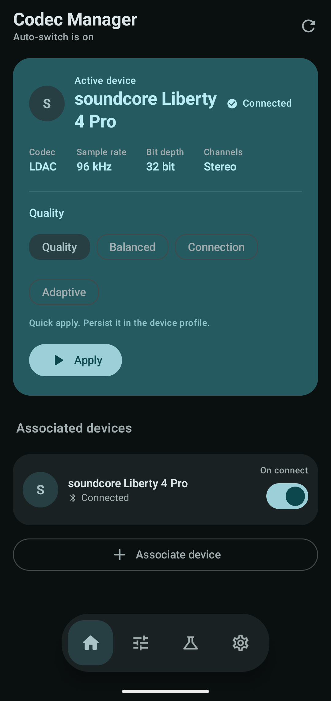
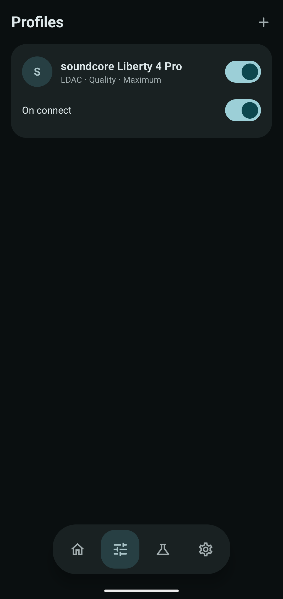
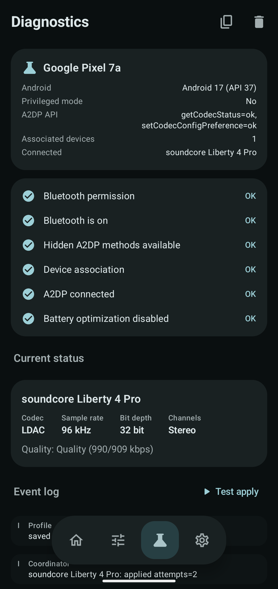
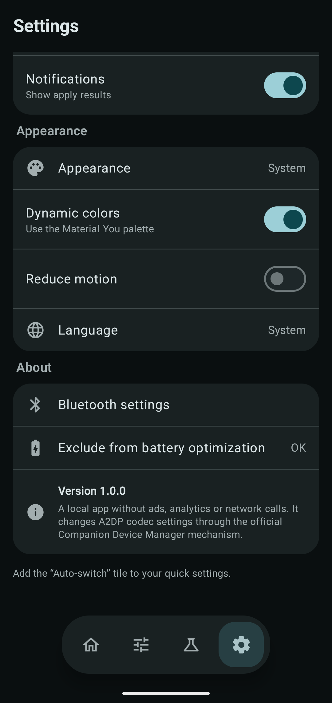

# Codec Manager

Android app that puts your Bluetooth audio codec under control.
When an LDAC headset connects, Codec Manager applies **Optimized for audio
quality** (990/909 kbps), verifies the result, and keeps an eye on it afterwards.


[](https://github.com/ArisoN-ext/Codec-Manager/actions/workflows/build.yml)

| Home | Profiles |
|---|---|
|  |  |

| Diagnostics | Settings |
|---|---|
|  |  |

## Features

- **Automatic LDAC quality on connect** — Quality / Balanced / Connection /
  Adaptive presets.
- **Device profiles** — per-headset quality, max/auto sample rate, apply-on-connect
  and an optional quality watchdog.
- **Background operation** — foreground service, notification actions, Quick
  Settings tile, boot receiver.
- **Material 3 Expressive UI** — floating navigation panel, dynamic color,
  expressive motion, light/dark theme, English and Russian.
- **Small release APK** — R8 + resource shrinking, ~3 MB.

## How it works

Changing an A2DP codec normally requires `BLUETOOTH_PRIVILEGED`, which is reserved
for system apps. Android 13 added an official exception: an app associated with
the headphones through `CompanionDeviceManager` may call the codec APIs.

Codec Manager uses that path:

1. The onboarding associates each headset with the app via the system dialog.
2. `CompanionDeviceService` reports when the headset appears.
3. The app waits for the A2DP connection, then reads
   `BluetoothA2dp.getCodecStatus()` through reflection.
4. It builds a `BluetoothCodecConfig` for LDAC (96 kHz, 32-bit, stereo,
   `codecSpecific1 = 1000`) and calls `setCodecConfigPreference()`.
5. It polls the status, and if nothing changed it sends a primer configuration
   (a different sample rate), then the target again.
6. A delayed re-check re-applies the profile if the system later resets it.

## Requirements

- Android 13 (API 33) or newer — this is where the CDM codec exception exists.
- A headset that supports LDAC, and a phone whose firmware exposes the hidden
  A2DP codec methods.
- `BLUETOOTH_CONNECT` and notification permissions.
- Battery optimization disabled for reliable background operation.

## Building

### Android Studio / command line

Requirements: JDK 21, Android SDK Platform 37, Build Tools 36.0.0 and 37.0.0.

```bash
git clone https://github.com/ArisoN-ext/Codec-Manager.git
cd Codec-Manager
./gradlew :app:assembleDebug
```

The APK is written to `app/build/outputs/apk/debug/app-debug.apk`.

### Nix

A flake with the exact JDK, Gradle and Android SDK is included:

```bash
nix develop
./scripts/build.sh debug     # or: release
./scripts/install.sh         # adb install + launch
```

> If you use the flake, keep the repository a git checkout: Nix only copies
> tracked files into the store.
